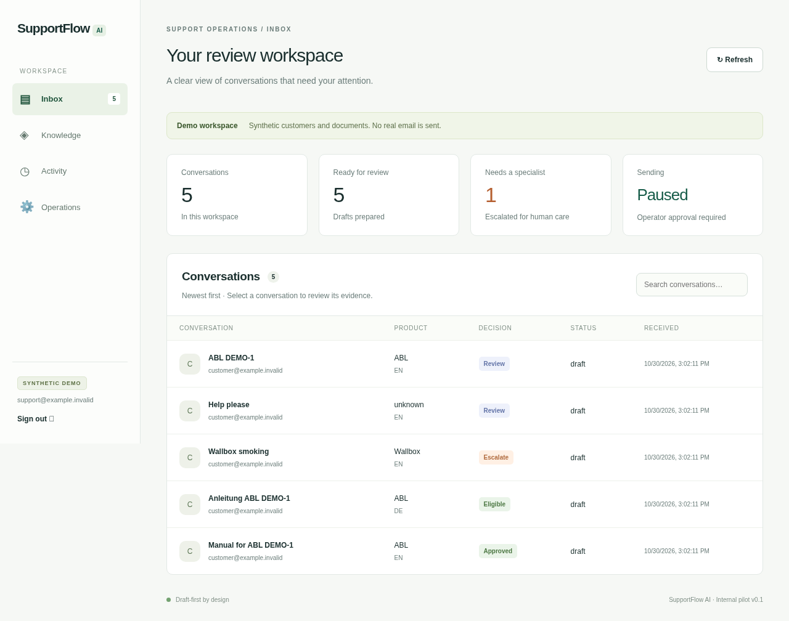

# SupportFlow AI

A configurable, draft-first support workspace for a business, with FastAPI, Next.js/TypeScript, PostgreSQL, and optional Gmail/Drive/Gemini connections. Deploy first, then complete **Business setup** in the application. Use one isolated installation and database per company. See [business onboarding](docs/BUSINESS_SETUP.md).

**This is a pilot implementation, not an authorized production agent.** It starts with synthetic data, automatic sending disabled, and the mailbox kill switch enabled. No real ABL/Wallbox manuals, customer data, company approvals, or invented API credentials are included. The full plan describes a 14–18 week organizational rollout; [delivery status](docs/DELIVERY_STATUS.md) distinguishes implemented capabilities from approval/access and future work.



## Hosted demo option

[Deploy on Render](https://render.com/deploy?repo=https://github.com/mherub004/SupportAI) after signing in and granting repository access. The Blueprint requests free plans and bundles the dashboard, API and worker with PostgreSQL. Review [setup and free-tier limitations](docs/RENDER.md): sleeping services are suitable for a demo, not production email automation.

## Start the synthetic demo

Prerequisites: Docker Engine with Compose v2 (supports optional dependencies), Python 3.12+ for the configuration helper.

```sh
python3 scripts/configure.py
docker compose --profile demo up --build -d --wait
python3 scripts/smoke.py
```

The helper creates a private, ignored `.env` with random local credentials and never overwrites an existing file. Open the dashboard on port **3000** on your development machine, then enter `OPERATOR_TOKEN` from your local `.env`. The API listens on port **8000**; `/docs` exposes its OpenAPI specification. Compose publishes both ports on loopback only. Demo responses and send IDs are simulated; nothing is delivered to a real mailbox.

Five synthetic messages demonstrate English/German manual requests, missing product details, electrical-safety escalation, and prompt injection. ABL `DEMO-1` is deliberately fictional. `example.invalid` links deliberately resolve nowhere. Do not use these assets for real product guidance.

```sh
docker compose ps
docker compose logs --tail=30 worker
docker compose down                 # retains the database volume
```

`docker compose --profile demo up -d --wait` is repeatable: message IDs and job keys prevent duplicate ingestion. Seeding refreshes synthetic source metadata; do not run the demo profile against real data. Only explicitly remove `supportflow_database` when you intend to discard its data.

## Develop without Docker

Python 3.12+, [uv](https://docs.astral.sh/uv/), Node.js 22+ and npm are required. From the repository root:

```sh
./scripts/dev.sh
```

This installs frozen dependencies, creates the initial schema, seeds demo data, and starts the API, worker and dashboard. Local development uses SQLite; use PostgreSQL for real connector testing or more than one process doing operator actions. The script shuts down its child services on exit. `.env` is shell-compatible configuration: edit values carefully and never source an untrusted file.

Individual checks, with their required working directories:

```sh
cd backend
uv sync --frozen
uv run ruff check .
uv run pytest -q
cd ../dashboard
npm ci
npm run build
npm run typecheck
# Against a running, seeded demo:
npx playwright install chromium
npm run test:e2e
```

If Chromium is already installed, use `CHROMIUM_PATH=/usr/bin/chromium npm run test:e2e`. End-to-end tests only change synthetic review/ownership state and do not send email. Synthetic bilingual evaluation cases live in `backend/evaluation/cases.jsonl`; their assertions are included in pytest. They do **not** establish the plan's SME-reviewed factual-correctness gate.

## Configure any business after deployment

The Business setup screen supports company details, response tone, human escalation policies, approved knowledge entry, encrypted connector settings, read-only verification, and draft-only activation. Unconfigured providers stay inactive. Saving changes pauses processing. Existing demo data is retained separately from live provider identities. Supported integrations are listed explicitly; unsupported services cannot be connected yet.

## What works

- Authenticated operator review workspace: inbox, source excerpts/revisions, response editing/approval, thread takeover, mailbox kill switch, knowledge registry, job status, audit metadata.
- SQL-backed durable queue with leases, bounded retries and unique ingestion keys; separate API and worker processes.
- Approved, effective, customer-safe knowledge filtered by exact brand, model and language. Unknown or ambiguous product models remain review-only. Retrieved source quotes and checksums are verified before use; send time rechecks source revisions and metadata.
- Deterministic safety, human-request, warranty/complaint, injection and loop checks. These conservative heuristics are pilot controls, not a general-purpose safety classifier.
- Gmail history reconciliation, authenticated Pub/Sub change signals, watch renewal, MIME threading, sender/mailbox checks, draft verification and uncertain-send reconciliation.
- Drive folder inventory, Docs/text/Markdown/PDF export, explicit approval metadata, atomic replacement/retirement and source-change detection during export.
- Gemini structured responses, provider interface, and bounded, scoped evidence context. The model receives customer message text only after you select Google mode; choose this route only after your organization's data-processing approval.
- Frozen dependency locks, container health checks, CI, synthetic fixtures, retention command and recovery runbook.

Only a deterministic **approved customer manual-link template** can become auto-send eligible. The broader setup/specification/clarification categories in the plan remain human-reviewed in this version. Free-form model prose is never automatically sent. Manual approval cannot override safety tags, paused threads, stale/ungrounded evidence or an uncertain operation. Handle those cases through your existing support process.

## Connect a nonproduction Google mailbox

Follow [Google setup](docs/GOOGLE_SETUP.md). Configure a dedicated approved Gmail user mailbox, Drive folder metadata, authentication and Gemini key securely in `.env`/your secret manager, set `CONNECTOR_MODE=google`, then start Compose **without** the demo profile. Start with `AUTO_SEND_ENABLED=false` and the kill switch on. No GCP resources or live mailbox credentials are provisioned by this repository.

The local operator token is a pilot authentication mechanism. For organizational rollout, put the private dashboard behind your SSO gateway and HTTPS, set `COOKIE_SECURE=true` and the exact `DASHBOARD_ORIGIN`, restrict direct API access, and implement per-user authorization/audit integration before production. See [security and limits](docs/SECURITY.md).

## Repository map

| Path | Purpose |
| --- | --- |
| `backend/app/main.py` | Authenticated API and Pub/Sub webhook |
| `backend/app/service.py` | Ingest, retrieval, policy decisions, draft/send reservations |
| `backend/app/google.py` | Gmail and Drive REST adapters |
| `backend/app/providers.py` | Demo and Gemini model providers |
| `backend/app/worker.py` | Durable job worker and periodic scheduling |
| `backend/app/cli.py` | Initial schema, synthetic seed, retention, reconciliation |
| `backend/tests/` | Functional, failure-injection, policy and adapter contract tests |
| `dashboard/` | Next.js operator application and browser tests |
| `docs/` | Original plan, architecture decision, operating/security guides, delivery map |

See [architecture](docs/ARCHITECTURE.md), [runbook](docs/RUNBOOK.md), and [delivery status](docs/DELIVERY_STATUS.md). No commercial license is granted by this repository; ownership/commercialization decisions in the plan remain with the appropriate rights holders.

## Cloudflare Workers

The Next.js dashboard has an OpenNext Workers deployment target. The Python API, background worker, and PostgreSQL need a separate HTTPS backend host. See [Cloudflare deployment](docs/CLOUDFLARE.md) for account authorization, secret configuration, build, and deployment steps.
