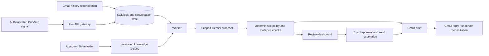

# Architecture decision: portable pilot core

Status: implemented for the pilot. Decision: PostgreSQL with a SQL-backed queue, rather than Firestore and Cloud Tasks. This follows the plan's self-hosting option and avoids binding core conversation/send state to GCP. SQLite is a single-machine demo/test convenience, not the supported production concurrency backend.

## Boundaries

`ModelProvider` and `MailProvider` describe the replaceable model and mailbox interfaces. The demo adapters are explicit simulations. Gmail/Drive use Google REST APIs; the Gemini adapter uses the Gemini Developer API's structured JSON endpoint, not Vertex AI. A Vertex adapter and approved enterprise retrieval are separate deployment decisions.

The database is authoritative for conversations, source registry, message dispositions, jobs, send reservations, audit events and reconciliation cursors. The worker runs separately from the API. Jobs are claimed with `FOR UPDATE SKIP LOCKED` on PostgreSQL; expired leases can be reclaimed and retries back off to five attempts. Run one worker initially; a lease must exceed expected provider processing time. Large-folder sync can exceed a lease and must be partitioned before scaling workers.

`create_all` creates the **initial v0.1 schema** idempotently; it does not upgrade an existing schema. Treat this as the initial schema migration. A versioned upgrade migration framework and backward-compatible release procedure must be introduced before a schema-changing release. Do not point this first version at an unknown preexisting database.

## Message lifecycle

1. Native Gmail history or a demo request supplies a canonical inbound message. Own messages, auto-replies, lists, spam, trash and drafts are excluded.
2. Ingest creates a conversation, a unique message row and a `process:<gmail-message-id>` job in one transaction. Replays are no-ops.
3. Language/brand/risk checks run before the model. Exact model matching scopes approved, effective, unexpired customer-safe documents. Context is bounded and every claimed quote must match the referenced revision verbatim.
4. The worker saves a decision, internal source URLs, excerpts, hashes and model version. Gmail draft creation is reserved **before** calling the API. A timeout or crash leaves a blocked uncertain state.
5. Operators inspect the exact recipient, response and evidence. Approval updates the Gmail draft and records the approved response checksum. Backend safety and ownership gates still apply.
6. Sending locks shared controls and conversation state, checks source metadata, exact Gmail draft, rate limit and ownership, then commits a unique send reservation. After reservation, ambiguous outcomes are never retried blindly.
7. Reconciliation searches Gmail for the deterministic RFC Message-ID. Finding a confirmed sent message can resolve state; absence does not prove no delivery. No reset/retry endpoint clears this protection.

This deliberately favors avoiding duplicate delivery over automatic liveness. It does **not** claim exactly-once delivery across an external Gmail API and a database. Gmail may accept a request even when a client times out.

## Knowledge lifecycle

Drive is authoritative for records prefixed `drive:`. The hourly sync fetches a complete direct-child inventory before atomically replacing approved records and retiring absent ones. Failed refreshes mark knowledge uncertain and block sends. The implementation uses hourly full reconciliation, not Drive change tokens yet. Folder nesting, shortcuts, OCR and very large files require a later ingestion extension.

Source URL and `customer_url` are separate: internal Drive links appear only as operator evidence. Automatic replies require an explicitly approved HTTPS customer URL. The URL's public accessibility/accuracy is part of knowledge-owner approval; the app does not change Drive sharing permissions.

## Deployment

Compose supplies PostgreSQL, schema initialization, optional demo seed, API, worker and Next.js. Processes do not survive snapshots; restart them using the saved startup instructions. The Next server exchanges a local operator login for an HttpOnly session cookie and proxies same-origin authenticated API calls; it never embeds the backend token in browser JavaScript. Session lifetime is one hour.

Cloud Run can host the stateless API/dashboard after the required enterprise integration work. The polling worker requires continuously allocated execution (worker pool, VM, Kubernetes or equivalent); do not deploy it as a scale-to-zero request-only service. Cloud Tasks/Firestore/Secret Manager/Cloud Logging adapters and infrastructure-as-code are not provisioned here.
