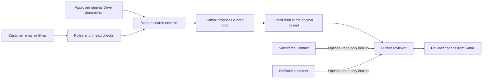

# Connect business email, knowledge, Salesforce and NetSuite

For a first personal-account trial, start with [the two-account test guide](PERSONAL_TEST.md): Google OAuth registration, sample knowledge, real email delivery checks and a supported-function checklist.

The application keeps these roles separate:

| System | Purpose | Current behavior |
| --- | --- | --- |
| Gmail | Receive customer messages and prepare replies in the original thread | Draft-only; a person sends from Gmail |
| Google Drive | Approved manuals, FAQs and policies | Browse, preview, approve exact file versions; sync retires changed/removed sources |
| NotebookLM | Research workspace using your original sources | No direct notebook/chat import; use its original Drive documents or reviewed source exports |
| Gemini | Generate an evidence-grounded draft | Receives bounded email text and approved document excerpts, not credentials or CRM results |
| Salesforce | Internal customer context | Read-only standard Contact lookup by the incoming sender's email |
| NetSuite | Internal customer context | Read-only standard customer lookup by the incoming sender's email |

## Recommended setup order

1. Save your company profile and support mailbox in **Business setup**. The mailbox must be a Gmail user account/approved primary address, not a Google Group.
2. Open **Google Workspace → Administrator setup — one time**. Register a Google OAuth Web application and copy the callback URL shown in this exact installation into its authorized redirect URIs. Save its client ID and client secret. Administrators must enable Gmail/Drive APIs, configure the consent screen/test users/internal organization policy, and approve the requested scopes.
3. Click **Connect Google account**, sign in to the intended support account, and approve access. SupportFlow uses authorization code + PKCE, offline access and a browser-bound, one-time, ten-minute state. It checks the selected Gmail profile against the configured mailbox and stores refresh credentials encrypted. No Google password belongs in the application.
4. Paste your approved **Drive folder link** into the Google card and save. Click **Verify access**. Saving Gmail/Drive settings pauses processing; reconnect is not needed for a folder-only change if your Google grant already includes Drive access.
5. Under Knowledge, click **Browse Google Drive folder**, preview a document, select business/product family, model (`general` for company policies), language and owner, and explicitly approve the version. This works before activating Gmail. A customer-facing URL is optional and separate from internal Drive links.
6. Save and verify the approved Gemini key/model. Review your organization's model/privacy terms before activation.
7. Optionally configure Salesforce and/or NetSuite using the steps below. They do not block Gmail/knowledge activation, and failed optional CRM access does not stop core draft processing.
8. Complete the readiness checks and activate **draft-only processing**. In Inbox, review the response and source quotes, optionally load CRM context, then use **Review drafts in Gmail** to send through your normal human workflow.

## NotebookLM and knowledge

A notebook is not automatically the authoritative company knowledge base. Use the original Google Docs, PDF manuals, Markdown/text files that you added as NotebookLM sources. Put approved customer-safe originals in a dedicated Drive folder and import them through the file browser. Do not connect an entire personal Drive or import NotebookLM-generated chats/answers as verified technical facts.

Local files can be uploaded to that approved Drive folder, or reviewed text can be entered using **Or paste an approved source manually**. Supported formats are Google Docs, text-extractable PDF, UTF-8 text and Markdown. Scanned PDFs need OCR first. Nested folders, shortcuts, spreadsheets, images and arbitrary notebook APIs are not implemented. Use a focused folder with at most 1,000 direct children for the browser; a source must have extractable text and at most 200,000 characters.

Approval is stored locally; SupportFlow does not modify Drive sharing settings or document metadata. A changed revision or modified timestamp requires reapproval for UI-managed sources. Retiring a source disables its use. The index periodically reconciles the selected folder; this is not instantaneous remote change detection. If a sync fails, technical drafting is withheld until the index is current again. Long documents use ranked bounded excerpts; citation quotes must also match the original full source, so separate excerpts cannot be joined into invented quotations.

The earlier appProperties workflow remains a legacy option for administrator-managed sources. UI-managed approvals take precedence and cannot be silently reapproved by old Drive properties.

## Salesforce — administrator once, then Connect

Register an OAuth external client app/connected app according to your Salesforce organization's current process. Enable authorization-code flow, PKCE and refresh-token/offline access. Register the exact **Salesforce callback URL** displayed by Business setup. Configure the `api`, `refresh_token` and `openid` scopes (the last enables identity verification through userinfo) and a least-privilege integration user/permission set with read access to standard Contact and its Account name. An API scope alone does not enforce read-only privileges; restrict the account's object permissions as well.

Save the client ID/secret and the login URL: production `https://login.salesforce.com`, sandbox `https://test.salesforce.com`, or your HTTPS My Domain origin. Click **Connect Salesforce**, authorize the intended organization, then **Verify access**. The application discovers the organization's instance URL from the token response and verifies organization identity. It uses fixed GET queries, never arbitrary user/LLM-generated SOQL.

Current lookup: one standard Contact matching the actual inbound email's From address; display record ID, contact name and Account name internally. Multiple matches are flagged ambiguous and no candidate details are returned. Custom CRM objects/field mappings, case actions, orders, updates and workflow automation are not supplied by this adapter.

## NetSuite — administrator once, then Connect

Use an OAuth **2.0 authorization-code integration**, not OAuth 1.0 token-based credentials. Enable the required OAuth 2.0/REST Web Services account features, configure authorization-code/PKCE support, and register the exact **NetSuite callback URL** shown in Business setup. Obtain its client ID/secret. Assign a dedicated read-only role with REST access, the necessary SuiteAnalytics/SuiteQL permissions and Customer view permission. Your administrator must confirm the exact role/features for your account.

Enter the account ID, including its sandbox suffix where applicable (for example the format `1234567_SB1`), save the client credentials, click **Connect NetSuite**, then verify. Account-specific hostnames are derived and validated. OAuth token exchange/refresh use the account-specific REST token endpoint with HTTP Basic client authentication. Rotating refresh tokens are encrypted and persisted before the subsequent API request.

Current lookup: standard customer records matching the inbound email exactly, via fixed `SELECT` SuiteQL. No transaction/customer modifications, refunds, orders, arbitrary SQL, RESTlet execution or accounting actions are performed. Multiple matches require manual handling. Custom schemas and additional record types require a separate supported adapter extension.

## CRM identity and privacy

Use **Load read-only CRM context** inside a real Gmail conversation. This is an explicit authenticated reviewer action and is unavailable for demo messages. Each verified optional provider reports matched, no match, ambiguous, not connected or unavailable independently.

An email address match is **not proof of identity**. Verify the customer using your existing business process before disclosing account information. CRM results are not passed to Gemini, inserted into drafts, or retained as response evidence. The audit records the provider/outcome, not customer record contents. There is no CRM write endpoint or model tool capable of changing records.

## Deployment and callbacks

Render supplies the public dashboard origin automatically through `RENDER_EXTERNAL_URL`. For a custom domain or separately hosted Workers dashboard, set **PUBLIC_APP_URL** on the backend to the exact dashboard HTTPS origin, with no path. Register the callback URLs displayed by the application in each provider. Changes invalidate pending authorization sessions. The generated local `.env` sets `PUBLIC_APP_URL=http://localhost:3000`; change it to your actual local dashboard port when needed. This file is excluded from the Render image, so the hosted service uses its platform-supplied origin.

The dashboard server needs the same OPERATOR_TOKEN as the backend. Account callbacks use an HttpOnly SameSite=Lax one-time binding cookie; the ordinary operator session remains HttpOnly/SameSite=Strict. Tokens and authorization codes are not returned to client JavaScript, reflected in redirects, or logged by application handlers. Configure reverse proxies/access logging to omit/redact OAuth callback query strings.

Maintain HTTPS/TLS verification and approved outbound access to Google, your Salesforce login/instance, and the account-specific NetSuite app/REST domains. Do not paste credentials in chat or Git. Administrators must review provider consent/OAuth verification requirements and legal/data-processing permissions. Real account interoperability requires your actual approved credentials; mocked tests and a local deployment do not establish authorization in your tenant.

Free Render sleep still pauses background processing. Use continuously available hosting before relying on mailbox polling, watch renewal or customer response deadlines. This remains one isolated installation/database per company and defaults to draft-only operation.
